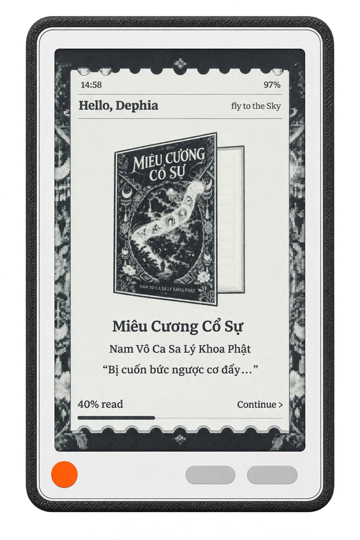
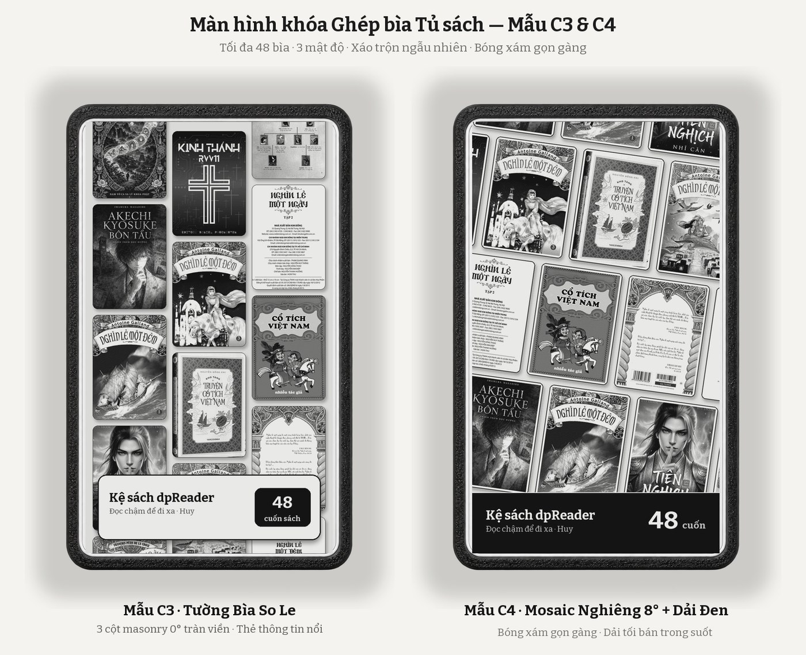
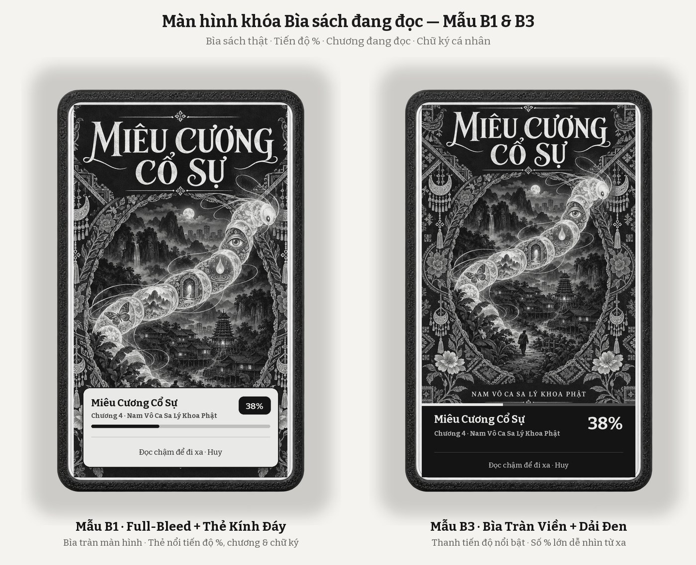
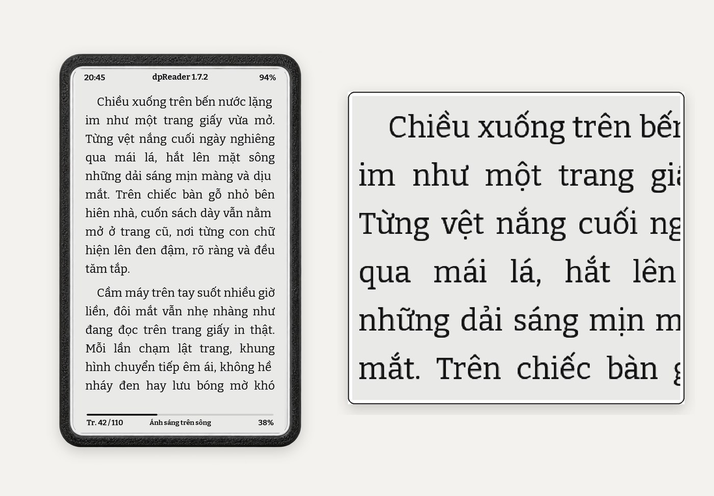
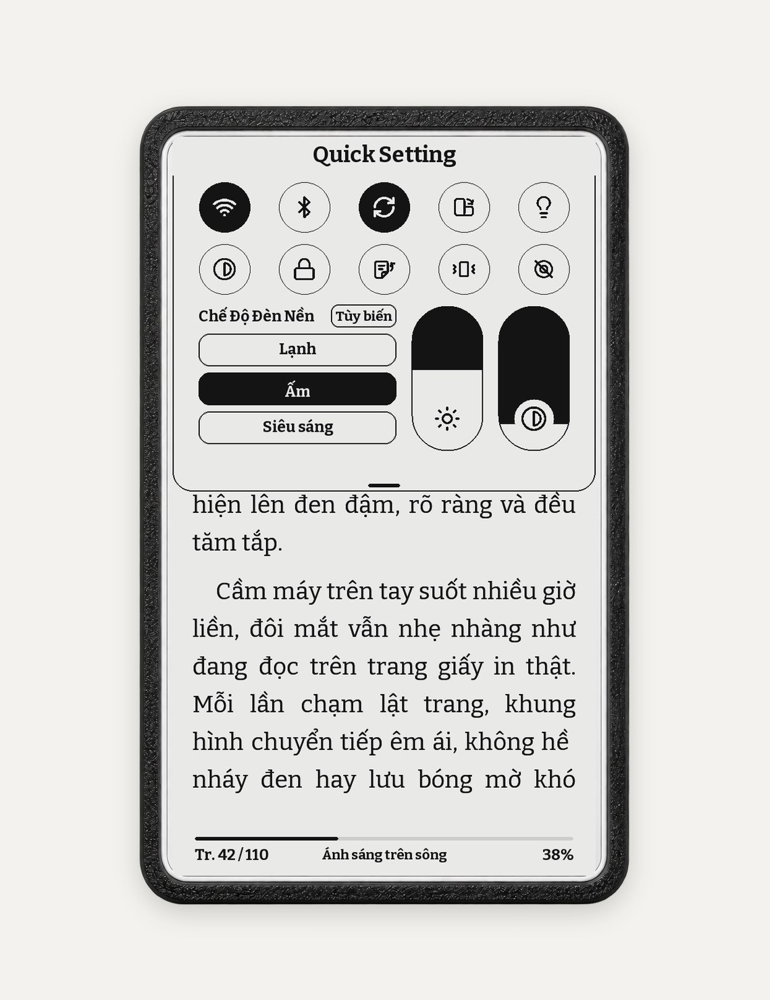

# dpReader — Give your Metalio a new chapter

[Tiếng Việt](README.md) · **English**

  
  

**Install or update dpReader directly in Chrome or Edge.** Connect your Metalio with a USB-C data cable and open Web Flash. No desktop installer is required.

|  |  |  |  |
| :---: | :---: | :---: | :---: |
| Full Home | I Love Book | New Home | Library |

## dpReader 1.7.3

Firmware for reading EPUB and TXT on the **Metalio E-Ink 4 Plus** (`metalio4.7`, 4.7 inches, ESP32-S31, 16 MB flash).

  

[Web Flash in English](https://dephia31.github.io/dpReader31/?lang=en) · [Download firmware 1.7.3](https://github.com/dephia31/dpReader31/releases/tag/v1.7.3-vn)

### 1. New Lock Screens: Cover Collage (C1/C3/C4) & Current Book Cover (B1/B3)

  

- **Cover Collage (Full)**: Much faster rendering with 3 layouts — **C1** (classic tilted), **C3** (3-column masonry + floating card), and **C4** (8° tilt, clean gray shadow without Polaroid frame, translucent dark band). Pick up to **48 books**, 3 densities, and **Recent / Random per lock / Fixed random** order, plus an instant **Shuffle** button with tap highlight and `#N` counter.

  

- **Current Book Cover (Full & Love Book)**: Displays your active book cover, chapter, `%` progress bar, and personal signature in 2 styles: **B1** (floating rounded card) and **B3** (translucent dark info band above a solid black signature strip).

### 2. Print-Sharp Text: `dpMetal Core`, `dpMetal Bold` & new `dpMetal Dark`

  

- **Deeper blacks without trailing washout**: Tuned `GC48`, `GC36`, `GL37`, and `22-phase` waveforms with **Core 1 RISC-V PIE SIMD** acceleration keep strokes dark and crisp through the final phase.
- **New `dpMetal Dark` mode (under `dpMetal Core`)**: Preserves `dpMetal Core`'s crisp thin strokes with fast 22-phase page turns and `GC48` periodic full refreshes for noticeably deeper black contrast.
- **`dpMetal Bold` & crisp UI labels**: Uniform black strokes across all font sizes without end-of-turn dark flashes; reading menus, TOC, choice popups, and Quick Settings use `dpMetal Bold` label rasterization.
- **Smart defaults**: Keeps **`dpMetal Core`** as default, enables **Large raised Drop Cap**, and turns **Embedded book fonts** off by default.

### 3. Dual Water-Ripple Turns (22-Phase & 37-Phase), SRAM Safety & Swipe Back

  

- **Dual Water-Ripple options**: Choose **Fast water ripple (22-phase)** for speed or **Smooth water ripple (37-phase)** for fluid page transitions with deep black text.
- **Internal SRAM safety & power protection**: Places I2C, touch, I/O-expander, and accelerometer structures in internal SRAM (`CONFIG_I2C_ISR_IRAM_SAFE=y`), adds critical-battery safe shutdown (saving progress and syncing SD), and cleanly tears down I/O, haptics, and display clocks for Deep Sleep.
- **Fast reading menus & left-edge swipe back**: Opens and closes top/bottom toolbars in a single refresh pass without touching body text; swipe right from the left edge to go back across all reading menus (portrait & landscape) and TOC.

### 4. Quick Settings & Soft-Start Frontlight Wake

  

- Pull down from the top edge for **Quick Settings** with **10 quick toggles**, **3 custom frontlight presets** (UTF-8 Vietnamese renameable), and **brightness / warmth sliders**.
- **Soft-start frontlight ramp** unified across both **Light Sleep** and **Deep Sleep** wake.

### 5. In-Book Search, Smart TOC & Connectivity

  

- **In-book search (TXT & EPUB)**: Accent-insensitive & accented Vietnamese matching, recent queries, instant Stop & view results, and quick search from text selection.
- **Nested TOC & percentage (%) jump**: Full portrait and landscape support.
- **Connectivity**: **KOSync** progress sync, **OPDS** catalogs, **Wi-Fi / Hotspot / USB** transfers, and **Bluetooth page-turner** support.

## Choose an edition and a Home layout

  

- **Full** includes a cover library, search, favorites, history, book management, and the **Cover Collage** lock screen. Full Home shows your current book, shortcuts and recent books.
- **Love Book** opens books from a file picker. The I Love Book layout centers on the current book, with a partly open cover, progress, and **Current Book Cover** lock screen.
- **New Home** is available in both editions. Tap **Continue reading** to open your book or tap **Today** to see your statistics. Change layouts under **Settings → Personalization → Home layout**.

## Reading and progress

Adjust fonts, text size, margins, line spacing and page-turn buttons. **Reading statistics** shows today's minutes, monthly reading time and active days, total reading time and a seven-day chart. Set a daily target under **Reading goal**.

  
  

## Install or update

1. Back up your settings to microSD. Keep a separate copy of your pre-upgrade backup if you may return to 1.5.1. Backups carrying a language choice in 1.5.2 use format V33.
2. Open **Web Flash** in a browser with Web Serial support, connect using a USB-C data cable and choose Full or Love Book. If the device does not appear, follow the page's BOOT instructions.
3. Choose **Application update** for dpReader 1.4.2 or later with the compatible 256 KiB NVS layout. Choose **Full install** when switching from other firmware, upgrading from 1.4.1 or earlier, or recovering a device. Full installation erases internal storage and preserves the microSD card.
4. Check the firmware version after restart. Devices with a compatible layout can update over Wi-Fi from 1.4.3 or use the microSD update package.

[Full USB bundle](releases/dpReader-metalio47-1.7.3-vn-USB.zip) · [Love Book USB bundle](releases/love-book/dpReader-metalio47-1.7.3-love-vn-USB.zip) · [Backup guide in Vietnamese](docs/BACKUP_AND_RESTORE.md)

## Transfer books and change language

Copy EPUB or TXT books to the books folder on microSD, or open **Files** to transfer over Wi-Fi, hotspot or USB. Use connection settings to browse OPDS catalogs and configure KOSync.

The first-run **Welcome** screen offers Vietnamese and English. Change the language under **Settings → Personalization → Language**. Book titles, author names and book contents retain their original text.

[Detailed Vietnamese guide](docs/CAI_DAT.md) · [License](LICENSE) · [Third-party notices](THIRD_PARTY_NOTICES.md)
