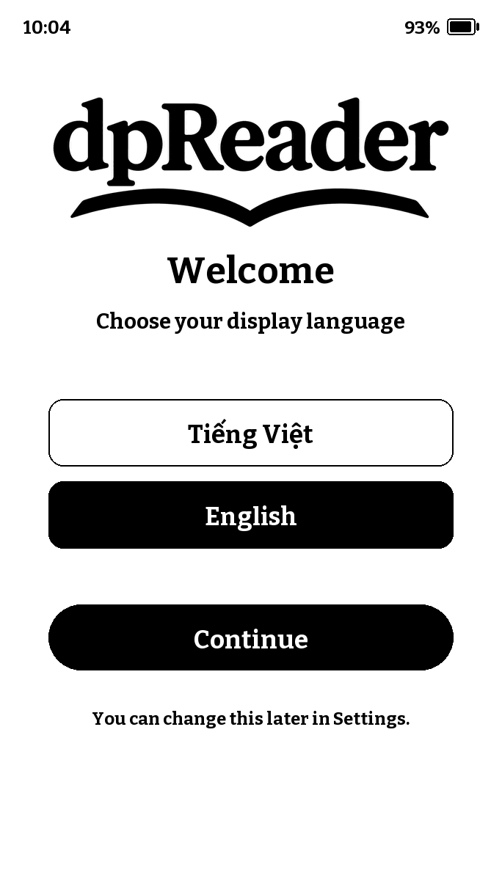

# dpReader — Give your Metalio a new chapter

[Tiếng Việt](README.md) · **English**

  
  

**Install or update dpReader directly in Chrome or Edge.** Connect your Metalio with a USB-C data cable and open Web Flash. No desktop installer is required.

|  |  |  |  |
| :---: | :---: | :---: | :---: |
| Full Home | I Love Book | New Home | Library |

## dpReader 1.6.8

Firmware for reading EPUB and TXT on the **Metalio E-Ink 4 Plus** (`metalio4.7`, 4.7 inches, ESP32-S31, 16 MB flash). Version 1.6.8 expands Quick Settings to 10 buttons, uses 4-level 22-phase + PIE SIMD text/UI rendering with optional `dpMetal White`, fixes nested TOC numbering, speeds up book opening/page turns, and optimizes battery.

[Web Flash in English](https://dephia31.github.io/dpReader31/?lang=en) · [Download firmware 1.6.8](https://github.com/dephia31/dpReader31/releases/tag/v1.6.8-vn)

## Choose an edition and a Home layout

- **Full** includes a cover library, search, favorites, history and book management. Full Home shows your current book, shortcuts and recent books.
- **Love Book** opens books from a file picker. The I Love Book layout centers on the current book, with a partly open cover and reading progress.
- **New Home** is available in both editions. Tap **Continue reading** to open your book or tap **Today** to see your statistics. Change layouts under **Settings → Personalization → Home layout**.

## Reading and progress

Adjust fonts, text size, margins, line spacing and page-turn buttons. Use the table of contents, bookmarks, a Bluetooth page turner or KOSync progress sync. The Full library can be browsed by book, author or folder.

**Reading statistics** shows today's minutes, monthly reading time and active days, total reading time and a seven-day chart. Set a daily target under **Reading goal**.

  
  

## Install or update

1. Back up your settings to microSD. Keep a separate copy of your pre-upgrade backup if you may return to 1.5.1. Backups carrying a language choice in 1.5.2 use format V33.
2. Open **Web Flash** in a browser with Web Serial support, connect using a USB-C data cable and choose Full or Love Book. If the device does not appear, follow the page's BOOT instructions.
3. Choose **Application update** for dpReader 1.4.2 or later with the compatible 256 KiB NVS layout. Choose **Full install** when switching from other firmware, upgrading from 1.4.1 or earlier, or recovering a device. Full installation erases internal storage and preserves the microSD card.
4. Check the firmware version after restart. Devices with a compatible layout can update over Wi-Fi from 1.4.3 or use the microSD update package.

[Full USB bundle](releases/dpReader-metalio47-1.6.8-vn-USB.zip) · [Love Book USB bundle](releases/love-book/dpReader-metalio47-1.6.8-love-vn-USB.zip) · [Backup guide in Vietnamese](docs/BACKUP_AND_RESTORE.md)

## Transfer books and change language

Copy EPUB or TXT books to the books folder on microSD, or open **Files** to transfer over Wi-Fi, hotspot or USB. Use connection settings to browse OPDS catalogs and configure KOSync.

The first-run **Welcome** screen offers Vietnamese and English. Change the language under **Settings → Personalization → Language**. Book titles, author names and book contents retain their original text.

[Detailed Vietnamese guide](docs/CAI_DAT.md) · [License](LICENSE) · [Third-party notices](THIRD_PARTY_NOTICES.md)
