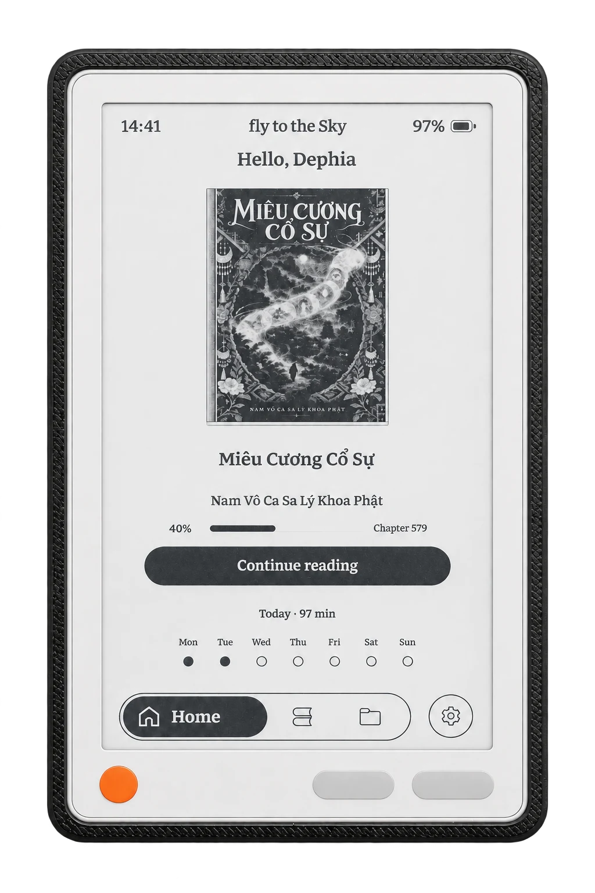
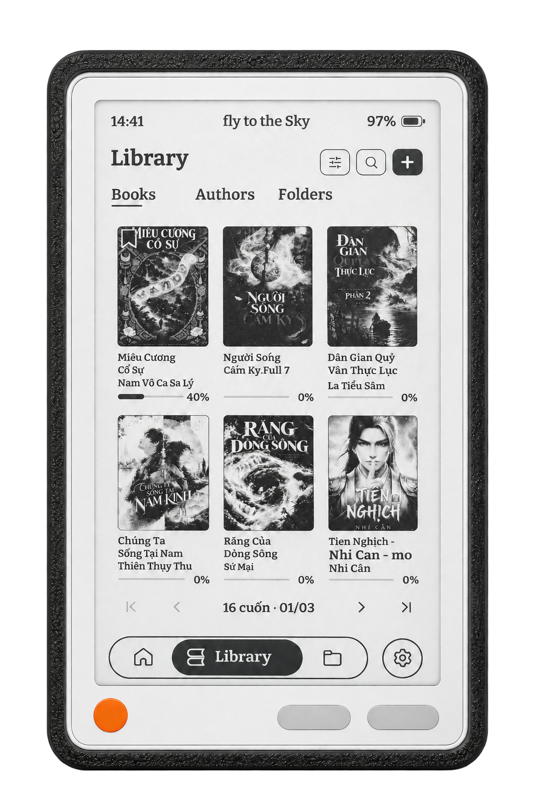
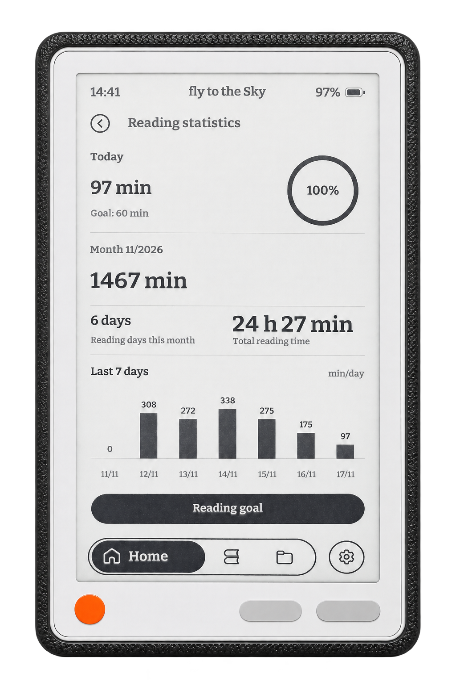
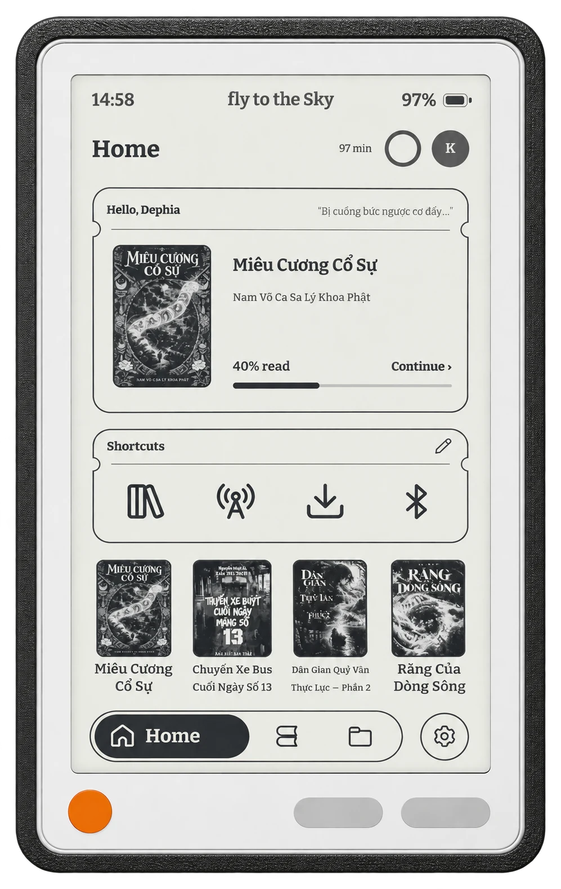
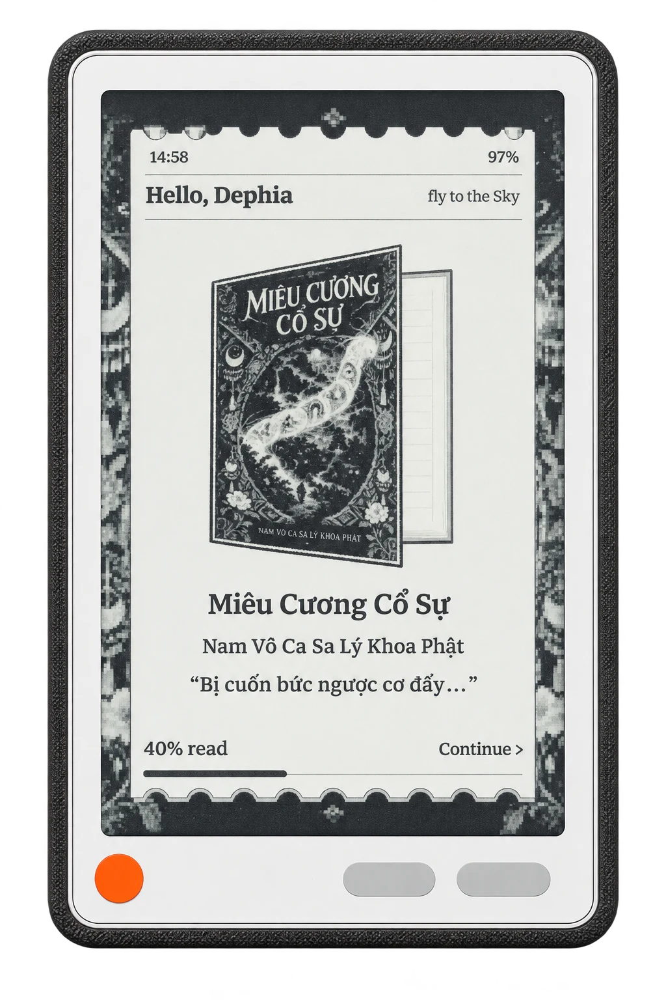

# dpReader for Metalio E-Ink 4 Plus

[Tiếng Việt](README.md) · **English**

  
  
  
  

  
  

*dpReader interface previews.*

dpReader is reading firmware for the **Metalio E-Ink 4 Plus** (`metalio4.7`), with a 4.7-inch 684 × 1216 e-ink screen, ESP32-S31 and 16 MB of flash.

[Web Flasher (English)](https://dephia31.github.io/dpReader31/?lang=en) · [Downloads](https://github.com/dephia31/dpReader31/releases/latest)

## Reading and library

- Read EPUB and TXT with adjustable fonts, type size, spacing, margins and page-turn controls.
- **Full** includes a cover-based library, search, favorites and book management. **Love Book** provides a simpler Home and opens books from a file picker.
- dpReader 1.5.2 includes **New Home**, with an at-a-glance reading progress bar and a shortcut to reading statistics. Statistics show reading time, active days and progress toward a daily goal.
- Transfer books over Wi-Fi or USB, browse an OPDS catalog, and sync reading progress with a KOSync account.

## Language

dpReader 1.5.2 offers **Tiếng Việt** and **English** on the first-run Welcome screen. You can also change the language under **Settings → Personalization → Language**. Book titles, author names and book contents use their original text. Keep a pre-upgrade backup for restoration on 1.5.1.

## Install or update

1. Back up settings to the microSD card and connect the reader using a USB-C data cable.
2. Open the [English Web Flasher](https://dephia31.github.io/dpReader31/?lang=en) in a browser that supports Web Serial. If the device is unavailable, follow the flasher’s BOOT instructions.
3. Choose **Full** or **Love Book**. For dpReader 1.4.2 and later with the compatible 256 KiB NVS layout, use **Application update**. For older firmware, another firmware family or device recovery, follow the **Full install** instructions. Full installation erases the reader’s internal flash and preserves the microSD card.
4. Follow the status on the page. Once the device restarts, check the running firmware version.

For the downloadable USB bundle, use `FLASH_USB.command` on macOS or `FLASH_USB.bat` on Windows. The [Vietnamese guide](README.md) contains detailed procedures for USB, microSD and Wi-Fi updates, plus KOSync and OPDS configuration.

See [LICENSE](LICENSE) for licensing details.
