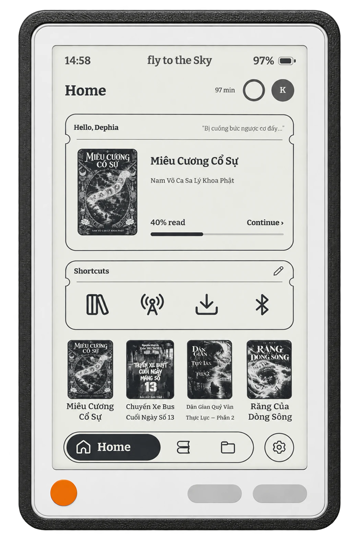
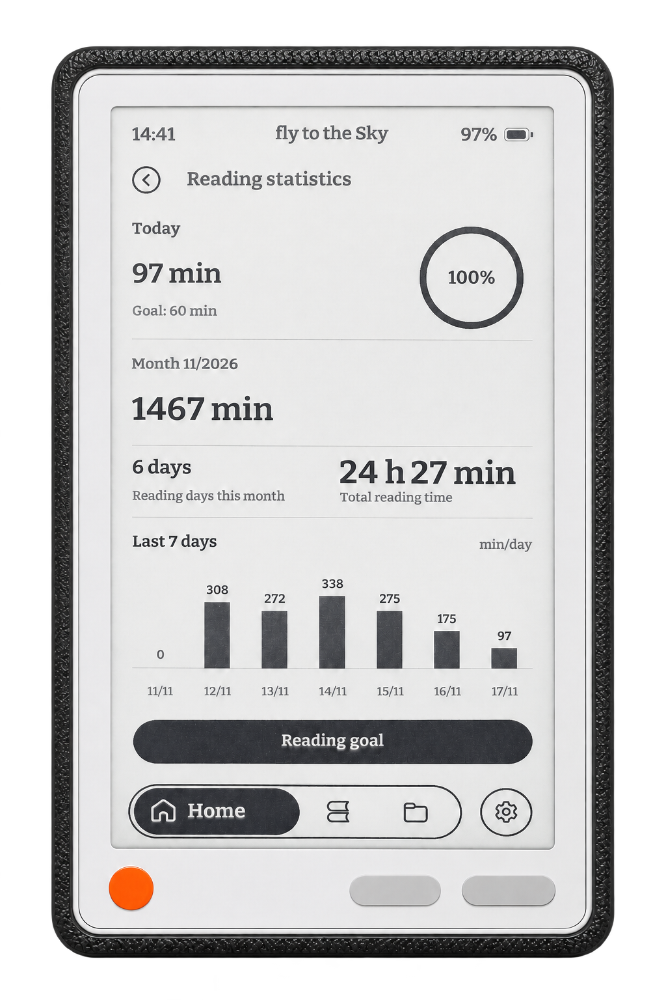

# dpReader — Chương mới cho máy đọc sách Metalio

**Tiếng Việt** · [English](README.en.md) · [English overview](#english-overview)

  
  

**Cài hoặc cập nhật dpReader ngay trên Chrome hoặc Edge.** Kết nối Metalio bằng cáp USB-C có truyền dữ liệu rồi mở Web Flash. Bạn có thể nạp trực tiếp từ trình duyệt.

|  |  |  |  |
| :---: | :---: | :---: | :---: |
| Đầy đủ | I Love Book | New Home | Tủ sách |

## dpReader 1.5.9

Firmware đọc EPUB và TXT dành cho **Metalio E-Ink 4 Plus 4,7 inch** (`metalio4.7`, ESP32-S31, flash 16 MB). Bản 1.5.9 thêm chọn nhanh máy chủ KoSync, đăng ký tài khoản và khớp sách theo Binary hoặc tên tệp.

[Web Flash](https://dephia31.github.io/dpReader31/) · [Tải firmware 1.5.9](https://github.com/dephia31/dpReader31/releases/tag/v1.5.9-vn)

## Chọn phiên bản và giao diện

- **Full** có Tủ sách dạng bìa, tìm kiếm, sách yêu thích, lịch sử và công cụ quản lý. Home Đầy đủ hiển thị sách đang đọc, tiện ích và sách gần đây.
- **Love Book** dùng trình chọn tệp để mở sách. I Love Book tập trung vào cuốn đang đọc, với bìa hé mở và tiến độ.
- **New Home** có trên cả hai phiên bản. Chạm **Đọc tiếp** để mở sách hoặc chạm vùng **Hôm nay** để xem thống kê. Chọn tại **Cài đặt → Cá nhân hóa → Giao diện**.

## Đọc sách và theo dõi tiến độ

Tùy chỉnh phông chữ, cỡ chữ, lề, giãn dòng và phím lật trang. Trình đọc hỗ trợ mục lục, dấu trang, điều khiển lật trang Bluetooth và đồng bộ tiến độ KOSync. Trong bản Full, Tủ sách có thể duyệt theo sách, tác giả hoặc thư mục.

Màn **Thống kê đọc sách** hiển thị số phút hôm nay, thời gian và số ngày đọc trong tháng, tổng thời gian và biểu đồ bảy ngày. Đặt số phút muốn đọc mỗi ngày trong **Mục tiêu đọc**.

  
  

## Cài đặt và cập nhật

1. Sao lưu cấu hình ra microSD. Nếu có thể cần quay về 1.5.1, giữ riêng bản sao lưu trước khi nâng cấp. Bản sao lưu có lựa chọn ngôn ngữ của 1.5.2 dùng định dạng V33.
2. Mở **Web Flash** bằng trình duyệt hỗ trợ Web Serial, kết nối máy bằng cáp USB-C có truyền dữ liệu và chọn Full hoặc Love Book. Nếu máy không hiện trong danh sách cổng, làm theo hướng dẫn vào BOOT trên trang.
3. Chọn **Cập nhật ứng dụng** nếu máy đang chạy dpReader 1.4.2 trở lên với bố cục NVS 256 KiB. Chọn **Nạp toàn phần** khi chuyển từ firmware khác, từ 1.4.1 trở xuống hoặc khi cần cứu máy. Nạp toàn phần xóa bộ nhớ trong và giữ nguyên thẻ microSD.
4. Kiểm tra phiên bản sau khi máy khởi động lại. Với máy đã dùng bố cục tương thích, có thể cập nhật qua Wi-Fi từ 1.4.3 hoặc dùng gói cập nhật microSD.

[Bộ USB Full](releases/dpReader-metalio47-1.5.9-vn-USB.zip) · [Bộ USB Love Book](releases/love-book/dpReader-metalio47-1.5.9-love-vn-USB.zip) · [Hướng dẫn sao lưu](docs/BACKUP_AND_RESTORE.md)

## Chép sách và đổi ngôn ngữ

Chép EPUB hoặc TXT vào thư mục sách trên microSD hoặc mở **Tệp** để truyền qua Wi-Fi, hotspot hay USB. Có thể duyệt kho OPDS và cài đặt KOSync trong phần kết nối.

Màn Welcome cho chọn **Tiếng Việt** hoặc **English** khi cài mới. Đổi ngôn ngữ bất cứ lúc nào tại **Cài đặt → Cá nhân hóa → Ngôn ngữ**. Tên sách, tác giả và nội dung sách hiển thị theo dữ liệu gốc.

[Hướng dẫn cài đặt và sử dụng](docs/CAI_DAT.md) · [Giấy phép](LICENSE) · [Thông báo bên thứ ba](THIRD_PARTY_NOTICES.md)

## English overview

dpReader is EPUB and TXT reading firmware for the **Metalio E-Ink 4 Plus (4.7-inch, ESP32-S31)**. Version 1.5.2 adds Vietnamese and English language selection, New Home, reading statistics and a redesigned dock. Choose **Full** for the cover library or **Love Book** for a simpler file-based reading experience.

[Read the full English guide](README.en.md) · [Open Web Flash in English](https://dephia31.github.io/dpReader31/?lang=en)
