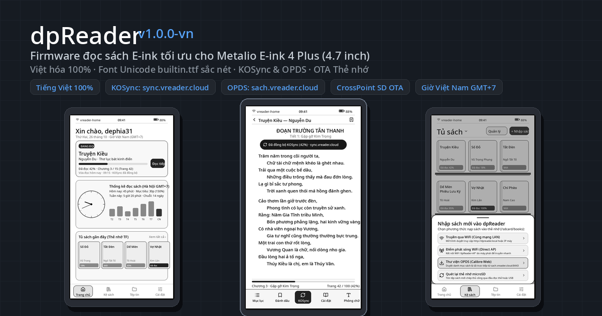
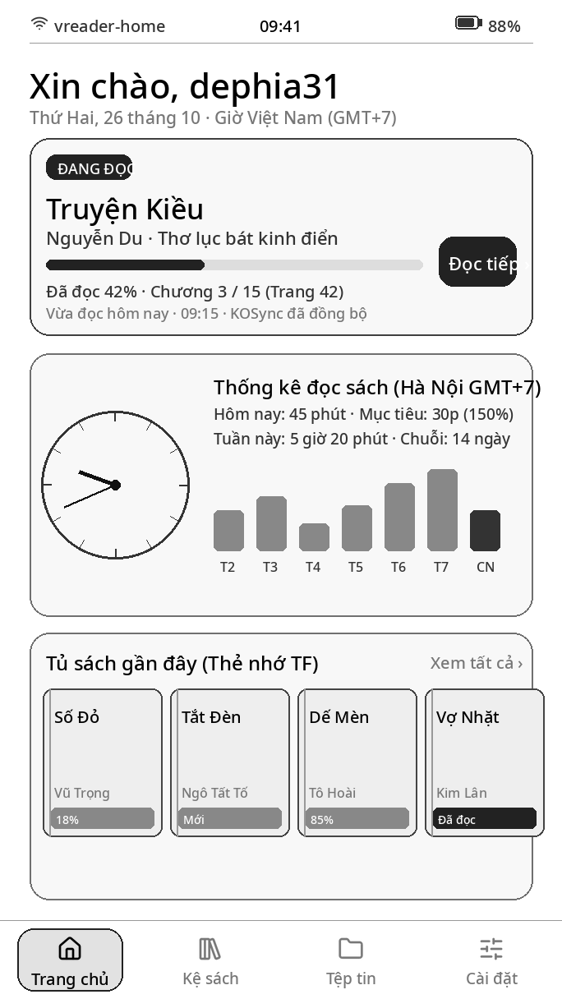
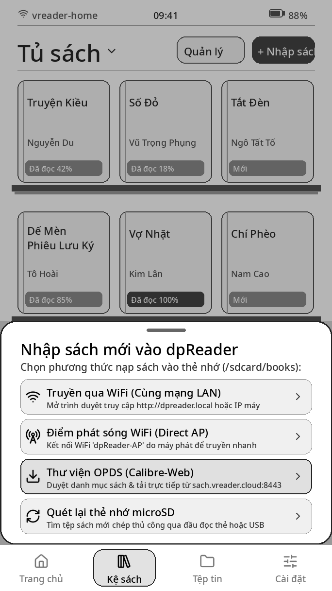
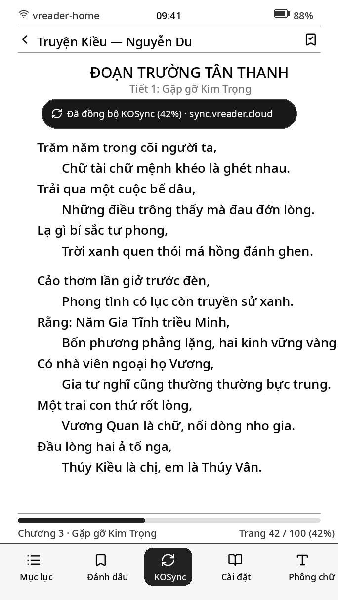
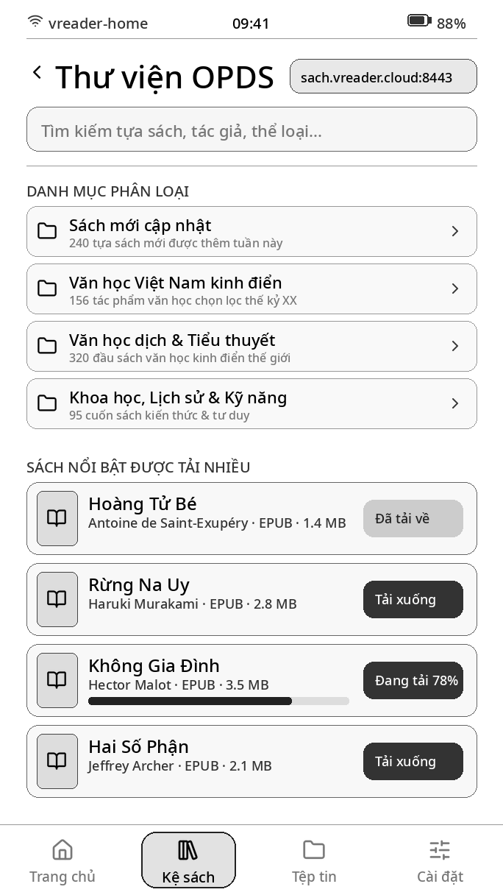
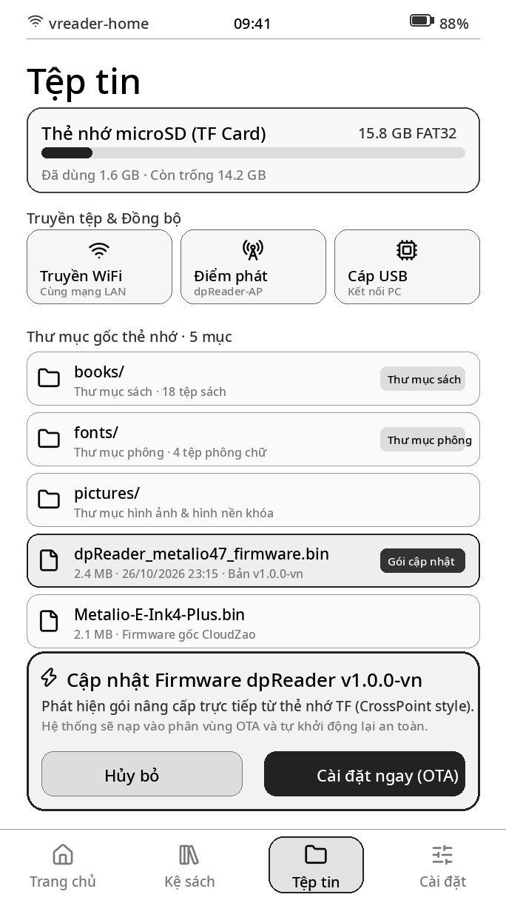
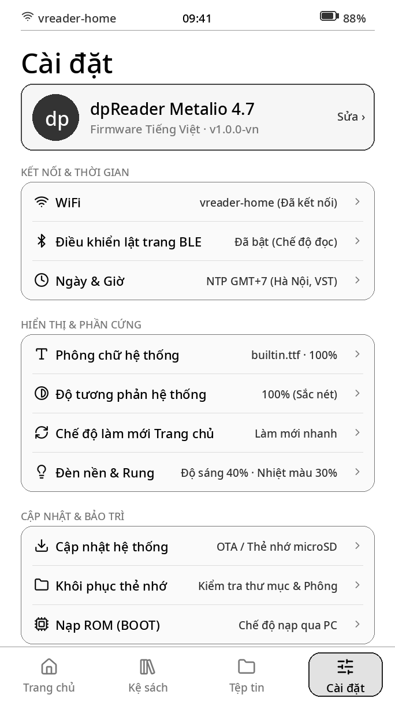
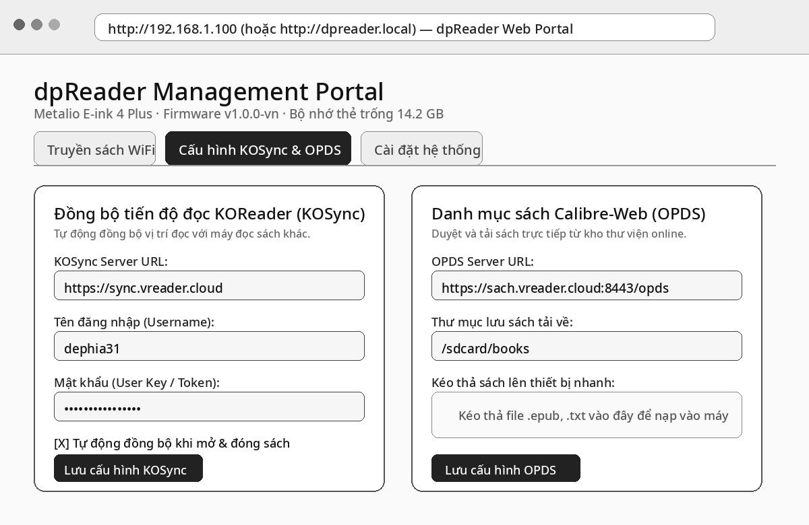

# dpReader — Firmware Đọc Sách Tiếng Việt Chuyên Biệt cho Metalio E-ink 4 Plus (`metalio4.7`)

<p align="center">
  
</p>

<p align="center">
  <a href="https://dephia31.github.io/dpReader31/"></a>
  <a href="https://github.com/dephia31/dpReader31/releases/latest"></a>
</p>

**dpReader** (`v1.1.3-vn`) là bản firmware đọc sách tùy biến và tối ưu hóa chuyên sâu cho máy đọc sách **Metalio E-ink 4 Plus (4.7 inch, 684×1216, SoC ESP32-S31 RISC-V, 16MB Flash + PSRAM)** dành riêng cho người dùng Việt Nam.

> ⚡ **Nạp Firmware Trực Tuyến 1-Click (Không cần cài phần mềm):**  
> Truy cập ngay **[Web Flasher chính thức](https://dephia31.github.io/dpReader31/)** trên trình duyệt Google Chrome hoặc Microsoft Edge để nạp firmware trực tiếp qua cáp USB-C. Tự động nhận diện phiên bản mới nhất, tự xóa `otadata` và tự khởi động lại máy sau khi nạp!

---

## 📸 Giao diện Thực tế Firmware dpReader

| Trang chủ (`app_dashboard.c`) | Kệ sách & Hộp thoại nạp sách (`app_book.c`) |
| :---: | :---: |
|  |  |
| *Thẻ Đọc tiếp, Đồng hồ Analog, Thống kê đọc trong tháng (GMT+7)* | *Lưới kệ sách tác phẩm kinh điển & Menu nạp sách WiFi / OPDS* |

| Màn hình đọc sách & KOSync (`app_book.c`) | Thư viện sách online OPDS (`opds_client.c`) |
| :---: | :---: |
|  |  |
| *Dàn trang thơ & tiểu thuyết Tiếng Việt, thanh công cụ KOSync* | *Duyệt Calibre-Web `sach.vreader.cloud:8443` & tải trực tiếp* |

| Quản lý tệp & Cập nhật thẻ nhớ (`app_files.c`) | Cài đặt hệ thống Tiếng Việt (`app_device_settings.c`) |
| :---: | :---: |
|  |  |
| *Quản lý thẻ nhớ TF & chạm 2 lần vào file `.bin` để cập nhật kiểu CrossPoint* | *Hồ sơ máy, WiFi, BLE, Ngày & Giờ GMT+7, Đèn nền & Rung* |

### 🌐 Cổng Quản lý Web Portal (`http://dpreader.local`)
<p align="center">
  
  <br>
  <em>Giao diện Web Portal quản lý truyền sách WiFi, cấu hình máy chủ KOSync (<code>https://sync.vreader.cloud</code>) và thư viện OPDS (<code>https://sach.vreader.cloud:8443/opds</code>)</em>
</p>

---

## ✨ Tính năng nổi bật trên dpReader

1. **Cô lập phần cứng `metalio47` & Tinh giản hệ thống (Debloat):**
   - Loại bỏ toàn bộ mã nguồn của các bo mạch ngoại lai (`pico` / `ESP32-S3`), bảng mã GBK, bộ gõ Pinyin, từ điển chữ Hán và các kho phông chữ trực tuyến nội địa Trung Quốc.
   - Tối ưu hóa bộ nhớ Flash và RAM nội bộ cho kết nối WiFi/TLS và điều khiển lật trang Bluetooth (BLE Page Turner).
2. **Giao diện & Phông chữ Tiếng Việt 100%:**
   - Toàn bộ giao diện hệ thống, cài đặt, thông báo, màn hình khóa và cổng truyền sách Web Portal (`http://dpreader.local`) được Việt hóa hoàn toàn.
   - Nhúng sẵn phông chữ hệ thống Tiếng Việt sắc nét (`Noto Sans Medium` `wght=500`, đầy đủ 134 ký tự Tiếng Việt dựng sẵn + dấu tổ hợp + ký hiệu điều hướng UI).
   - Thuật toán **ngắt dòng theo từ Tiếng Việt (Word-Wrap)** cho cả `EPUB` và `TXT` (không cắt ngang giữa âm tiết Tiếng Việt), tự động nhận diện mục lục Tiếng Việt (`Chương`, `Phần`, `Hồi`, `Quyển`, `Tập`, `Mục`, `Lời mở đầu`, `Ngoại truyện`...) và tìm kiếm sách không phân biệt dấu Tiếng Việt.
   - Đồng bộ giờ chuẩn Việt Nam (`GMT+7` / `ICT-7`) qua cụm máy chủ NTP `vn.pool.ntp.org`.
3. **Đồng bộ tiến độ đọc KOReader Sync (`KOSync`):**
   - Tích hợp module `kosync_client` sử dụng thuật toán băm tài liệu chuẩn `partialMD5` tương thích 100% với **KOReader** trên Android, Kindle, Kobo, Boox.
   - Máy chủ mặc định: **`https://sync.vreader.cloud`** (hỗ trợ nhập rút gọn `sync.vreader.cloud` và tùy chỉnh máy chủ riêng trên Web Portal).
   - Hỗ trợ tự động đồng bộ tiến độ đọc khi mở/đóng sách hoặc bấm nút đồng bộ nhanh ngay trong menu đọc sách.
4. **Duyệt & Tải sách trực tiếp từ Thư viện OPDS (`Calibre-Web`):**
   - Tích hợp trình duyệt `opds_client` chuẩn OPDS 1.2 Atom XML ngay tại **Tủ sách -> `+ Nhập sách` -> `Thư viện OPDS`**.
   - Danh mục OPDS mặc định: **`https://sach.vreader.cloud:8443/opds`** (hỗ trợ tài khoản HTTP Basic Auth và tùy chỉnh địa chỉ trên Web Portal).
   - Hỗ trợ duyệt thư mục, phân trang và tải trực tiếp sách `.epub` / `.txt` về thẻ nhớ `/sdcard/books`.
5. **Đa dạng phương thức Cập nhật & Flash Firmware:**
   - **Web Flasher trực tuyến 1-Click:** Truy cập [https://dephia31.github.io/dpReader31/](https://dephia31.github.io/dpReader31/) trên trình duyệt Chrome/Edge để nạp trực tiếp qua cáp USB-C, không cần cài đặt phần mềm hay driver phức tạp.
   - **Cập nhật OTA qua Wi-Fi:** Máy tự động kích hoạt kết nối Wi-Fi đã lưu, kiểm tra máy chủ và tải bản cập nhật mới nhất chỉ với 1 chạm trong **Cài đặt -> Cập nhật hệ thống**.
   - **Nâng cấp trực tiếp bằng Thẻ nhớ MicroSD:** Hỗ trợ nâng cấp từ cả **ROM gốc nhà sản xuất (`CloudZao/Metalio-E-INK4-Plus`)** lẫn **ROM `Kiikoread`** mà không cần máy tính hay cáp USB.
   - **Cài đặt kiểu CrossPoint Reader:** Chạm 2 lần vào bất kỳ file `.bin` nào trong **Quản lý tệp (`Tệp`)** để cài đặt trực tiếp ngay trên máy.

---

## 📦 Các tệp Firmware phát hành (Thư mục [`releases/`](releases/))

| Tệp nhị phân | Kích thước | Mục đích sử dụng | Địa chỉ / Đường dẫn |
| :--- | :--- | :--- | :--- |
| **[`releases/dpReader_metalio47_firmware.bin`](releases/dpReader_metalio47_firmware.bin)** | `~3.82 MB` | Dùng để **cập nhật qua thẻ nhớ MicroSD** (từ ROM gốc hoặc từ `dpReader`) hoặc nạp nhanh phân vùng `ota_0`. | Thẻ nhớ SD hoặc `0x10000` |
| **[`releases/dpReader_metalio47_full.bin`](releases/dpReader_metalio47_full.bin)** | `~3.88 MB` | File gộp toàn bộ 4 phân vùng (`bootloader` + `partition-table` + `otadata` + `firmware`) để nạp mới hoàn toàn hoặc cứu máy qua cáp USB-C. | `0x0` |
| **[`releases/SHA256SUMS.txt`](releases/SHA256SUMS.txt)** | — | Mã kiểm tra toàn vẹn `SHA-256` của các bản build. | — |

---

## 🔄 Phần 1: Các Cách Update Firmware qua Thẻ nhớ MicroSD (Không cần cáp USB Flash)

> **Lưu ý chung khi dùng thẻ nhớ MicroSD:**
> - Thẻ nhớ phải ở định dạng **FAT32** (không dùng `exFAT` hay `NTFS`).
> - Khi cập nhật bằng thẻ nhớ, luôn sử dụng file ứng dụng đơn **`dpReader_metalio47_firmware.bin`** (không dùng file gộp `full.bin`).

### Cách 1: Chuyển từ Firmware gốc xuất xưởng của nhà sản xuất (`CloudZao/Metalio-E-INK4-Plus`) sang `dpReader`
Nếu máy của bạn đang chạy ROM gốc của nhà sản xuất (bản có trợ lý giọng nói AI Baiwen, giao diện LVGL):
1. Lắp thẻ nhớ vào máy tính hoặc bật chế độ **Transfer -> USB transfer** ngay trên máy Metalio để kết nối thẻ nhớ qua cáp USB.
2. Sao chép file **`dpReader_metalio47_firmware.bin`** vào **thư mục gốc (Root)** của thẻ nhớ và đổi tên thành chính xác:
   ```text
   Metalio-E-Ink4-Plus.bin
   ```
3. Tắt nguồn máy đọc sách rồi bật lại (nhấn giữ nút Nguồn 3 giây để tắt, sau đó bật lại).
4. Ngay khi khởi động, ROM gốc `CloudZao` sẽ tự động phát hiện file `/sdcard/Metalio-E-Ink4-Plus.bin` và hiện hộp thoại **"SD卡发现新固件" (Phát hiện firmware mới trên thẻ nhớ SD)** -> chạm chọn **"立刻升级" (Nâng cấp ngay)**.
5. Đợi thanh tiến trình chạy đến `100%`. Máy sẽ tự động xóa file `.bin` mồi trên thẻ nhớ và khởi động thẳng vào giao diện **dpReader Tiếng Việt** (toàn bộ sách `.epub`/`.txt` cũ trong `/sdcard/metalio/e-ink/books` sẽ tự động xuất hiện trên Tủ sách của `dpReader`!).

### Cách 2: Chuyển từ nhánh Firmware `Metalio-S31-kiikoread` sang `dpReader`
Nếu máy của bạn đang chạy bản `Kiikoread` tiếng Trung/Anh/Nhật:
1. Sao chép file **`dpReader_metalio47_firmware.bin`** vào **thư mục gốc (Root)** của thẻ nhớ và đổi tên thành:
   ```text
   Metalio-S31-update.bin
   ```
2. Trên máy đọc sách, mở **设置 (Cài đặt) -> 系统升级 (Cập nhật hệ thống) -> 安装 TF 卡升级包 (Cài đặt gói cập nhật trên thẻ nhớ)**.
3. Máy sẽ kiểm tra chữ ký, ghi vào phân vùng OTA và tự khởi động lại vào **dpReader Tiếng Việt**.

### Cách 3: Cập nhật phiên bản mới khi máy đã chạy `dpReader` (Kiểu CrossPoint hoặc Cài đặt)
Khi máy đã ở giao diện **dpReader**, bạn có thể cập nhật các bản build mới bằng **1 trong 2 cách**:
- **Phương án 3A — Duyệt và bấm trực tiếp file `.bin` trong Quản lý tệp (Giống CrossPoint Reader):**
  1. Chép file `.bin` (ví dụ `dpReader_metalio47_firmware.bin`, không cần đổi tên) vào bất kỳ thư mục nào trên thẻ nhớ (hoặc tải lên qua WiFi Transfer).
  2. Mở ứng dụng **Quản lý tệp (`Tệp`)** trên máy đọc sách, điều hướng tới file `.bin`:
     - **Chạm lần 1:** Máy kiểm tra header & hiển thị thông báo *"Gói cập nhật 1.0.1-vn: chạm lần nữa để cài đặt"*.
     - **Chạm lần 2:** Máy tự động ngắt cao áp màn hình E-ink an toàn, ghi firmware mới vào phân vùng OTA và tự khởi động lại.
- **Phương án 3B — Cài đặt từ mục Cập nhật hệ thống:**
  1. Chép file vào thư mục gốc thẻ nhớ với một trong các tên: `dpReader-update.bin`, `dpReader_metalio47_firmware.bin`, `Metalio-E-Ink4-Plus.bin`, hoặc `Metalio-S31-update.bin`.
  2. Vào **Cài đặt -> Cập nhật hệ thống -> Cài đặt gói cập nhật trên thẻ nhớ**.

---

## 💻 Phần 2: Các Cách Flash Firmware qua Cáp USB-C (Dành cho nạp mới toàn bộ / Chia lại phân vùng / Cứu máy)

Nếu bạn muốn nạp sạch toàn bộ bảng phân vùng chuẩn của `dpReader` (để có thêm **5.87 MB** bộ nhớ trong `/flash` khi dùng máy không thẻ nhớ) hoặc cứu máy khi treo logo, hãy nạp qua cáp USB-C.

### Bước 1: Đưa máy Metalio E-ink 4 Plus về chế độ Nạp ROM (Download Mode / BOOT)
Chọn **1 trong 2 cách**:
- **Cách 1 (Trên màn hình cảm ứng — Nếu máy đang ở `dpReader` hoặc `Kiikoread`):**
  - Vào **Cài đặt -> Nạp ROM qua máy tính (BOOT) -> Mở cổng nạp ROM**, sau đó cắm cáp USB-C vào máy tính.
- **Cách 2 (Bằng phím cứng — Áp dụng cho mọi ROM hoặc khi máy đang tắt nguồn):**
  - Cắm cáp USB-C kết nối máy đọc sách với máy tính.
  - Nhấn giữ đồng thời **Nút Giữa (phím BOOT - GPIO61)** và **Nút Nguồn** khoảng 3–5 giây cho đến khi máy tính nhận thiết bị cổng COM / `USB JTAG/serial debug unit`.

### Bước 2: Chọn công cụ Flash trên máy tính

#### Cách 4: Nạp bằng dpReader Web Flasher Trực Tuyến (Khuyên dùng — 1-Click qua Trình duyệt)
Trang Web Flasher chính thức của dpReader được tích hợp sẵn công nghệ Web Serial API, cho phép nạp firmware trực tiếp từ trình duyệt mà không cần cài đặt Python, esptool hay driver phức tạp:

👉 **Truy cập ngay:** **[https://dephia31.github.io/dpReader31/](https://dephia31.github.io/dpReader31/)**

1. **Chuẩn bị:** Mở trình duyệt **Google Chrome** hoặc **Microsoft Edge** trên máy tính (Windows, macOS hoặc Linux).
2. **Đưa máy về chế độ nạp ROM (BOOT):**
   - Cắm cáp USB-C kết nối máy đọc sách với máy tính.
   - Nhấn giữ đồng thời **Nút Giữa (phím BOOT)** và **Nút Nguồn** khoảng 3–5 giây (hoặc vào **Cài đặt -> Nạp ROM qua máy tính -> Mở cổng nạp ROM**).
3. **Kết nối:** Bấm nút **Kết nối Thiết bị** trên trang web và chọn thiết bị có tên `USB JTAG/serial debug unit` (hoặc cổng COM tương ứng).
4. **Chọn chế độ nạp:**
   - **Nâng cấp Ứng dụng (Khuyên dùng):** Nạp bản cập nhật mới nhất vào offset `0x10000`, tự động xoá `otadata` để máy boot ngay vào bản mới, **giữ nguyên toàn bộ sách, ghi chú, WiFi và cài đặt VCOM**.
   - **Nạp Toàn Diện (Full Flash):** Nạp toàn bộ hệ thống từ offset `0x0` (`Bootloader` + `Partition Table` + `Otadata` + `Firmware`) dành cho máy mới xuất xưởng hoặc cứu máy bị lỗi hệ điều hành.
   - *(Hoặc bạn có thể chọn "Tự chọn file .bin từ máy tính" nếu muốn nạp một bản build riêng).*
5. **Tiến hành nạp:** Bấm **Bắt đầu Nạp Firmware**. Trang web sẽ tự động tải file nhị phân mới nhất từ máy chủ với cơ chế chống cache, hiển thị thanh tiến trình % trực quan.
6. **Tự động khởi động lại:** Khi thanh tiến trình đạt `100%`, Web Flasher sẽ tự động phát xung reset cứng (RTS/EN) để khởi động lại máy thẳng vào hệ điều hành `dpReader` mới và tự động nhả cổng kết nối USB.

#### Cách 5: Flash bằng công cụ dòng lệnh `esptool.py` (Windows / macOS / Linux)
Cài đặt `esptool` (`pip install esptool`), sau đó mở Terminal / Command Prompt tại thư mục chứa file `.bin`:

- **Nạp trọn bộ Full Flash (Bootloader + Partition Table + OTA Data + Firmware) từ địa chỉ `0x0`:**
  ```bash
  python3 -m esptool --chip esp32s31 --baud 460800 write_flash 0x0 releases/dpReader_metalio47_full.bin
  ```
  > ⚠️ Lệnh này **xoá NVS** (cài đặt, mật khẩu, VCOM đã hiệu chuẩn) vì `full.bin` trải liền từ `0x0` và vùng NVS trong file là `0xFF`. Dùng khi cần nạp sạch / chia lại phân vùng / cứu máy.
- **Hoặc chỉ nạp nhanh phân vùng ứng dụng `ota_0` tại địa chỉ `0x10000` (giữ nguyên NVS):**
  ```bash
  python3 -m esptool --chip esp32s31 --baud 460800 write_flash 0xd000 ota_clear.bin 0x10000 releases/dpReader_metalio47_firmware.bin
  ```
  > Lệnh này **không** đụng tới NVS, nên VCOM và cài đặt được giữ lại. Dùng khi máy đã có bảng phân vùng của dpReader và chỉ muốn cập nhật firmware.
  >
  > `ota_clear.bin` là tệp 8 KB toàn `0xFF` (xoá `otadata`). **Bắt buộc** phải kèm theo: nếu máy từng cập nhật qua Wi-Fi, `otadata` có thể đang trỏ `ota_1` và máy sẽ khởi động lại vào bản **cũ** dù `ota_0` đã ghi xong. Tạo tệp bằng `python3 -c "open('ota_clear.bin','wb').write(b'\xff'*8192)"`, hoặc dùng `./flash_firmware.sh --app` để script tự lo.

#### Bảng sơ đồ phân vùng Flash 16MB (`boards/metalio47/partitions.csv`)
| Phân vùng | Loại / Phụ loại | Địa chỉ (`Offset`) | Kích thước | Ghi chú |
| :--- | :--- | :--- | :--- | :--- |
| `bootloader` | Bootloader | `0x2000` | `24 KB` | Bootloader cấp 2 của `ESP32-S31` (bắt đầu tại `0x2000`) |
| `partition-table` | Partition Table | `0x8000` | `4 KB` | Bảng phân vùng hệ thống |
| `nvs` | `data` / `nvs` | `0x9000` | `16 KB` | Lưu cài đặt máy, WiFi, thông số VCOM, cấu hình KOSync & OPDS |
| `otadata` | `data` / `ota` | `0xd000` | `8 KB` | Trạng thái phân vùng OTA đang khởi động |
| `phy_init` | `data` / `phy` | `0xf000` | `4 KB` | Dữ liệu hiệu chuẩn RF WiFi/BLE |
| `ota_0` | `app` / `ota_0` | `0x10000` | `5 MB` (`0x500000`) | Phân vùng chứa Firmware chính |
| `ota_1` | `app` / `ota_1` | `0x510000` | `5 MB` (`0x500000`) | Phân vùng OTA dự phòng (cập nhật qua thẻ nhớ / mạng) |
| `storage` | `data` / `fat` | `0xa10000` | `~5.87 MB` (`0x5e0000`) | Bộ nhớ trong `/flash` lưu tiến độ đọc, chỉ mục sách, bộ nhớ đệm |
| `coredump` | `data` / `coredump` | `0xff0000` | `64 KB` (`0x10000`) | Lưu nhật ký coredump khi xảy ra lỗi |

---

## ☁️ Phần 3: Hướng dẫn Thiết lập Đồng bộ KOSync & Thư viện OPDS

1. Trên máy đọc sách, mở **Tủ sách -> `+ Nhập sách` -> Truyền WiFi / Điểm phát** (hoặc **Quản lý tệp -> Truyền WiFi**).
2. Kết nối máy vào mạng WiFi và mở địa chỉ hiển thị trên màn hình (ví dụ `http://dpreader.local` hoặc `http://192.168.1.xxx`) bằng trình duyệt điện thoại hoặc máy tính.
3. Kéo xuống mục **Đồng bộ KOSync & Thư viện OPDS**:
   - **Máy chủ KOSync:** Mặc định là **`https://sync.vreader.cloud`** (có thể nhập `sync.vreader.cloud`). Điền tài khoản/mật khẩu KOReader Sync và bật *Tự động đồng bộ tiến độ khi mở/đóng sách*.
   - **Danh mục OPDS:** Mặc định là **`https://sach.vreader.cloud:8443/opds`** (có thể nhập `sach.vreader.cloud:8443/opds`). Điền tài khoản/mật khẩu OPDS nếu kho sách yêu cầu xác thực.
   - Nhấn **Lưu cấu hình KOSync & OPDS**.
4. **Sử dụng trên máy đọc sách:**
   - **Tải sách OPDS:** Vào **Tủ sách -> `+ Nhập sách` -> `Thư viện OPDS`**, chạm vào danh mục hoặc đầu sách để tải trực tiếp về `/sdcard/books`.
   - **Đồng bộ KOSync:** Tiến độ đọc sẽ tự động đồng bộ khi mở/đóng sách hoặc khi bấm biểu tượng **Đồng bộ KOSync** trong thanh công cụ đọc sách.

---

## 🛠️ Phần 4: Hướng dẫn Build từ Mã nguồn (Dành cho Developer)

### 1. Yêu cầu môi trường
- **ESP-IDF v6.1** (có hỗ trợ target `esp32s31` và toolchain `riscv32-esp-elf`)
- **Python 3.10+** kèm thư viện `fonttools` và `esptool`

```bash
mkdir -p ~/esp && cd ~/esp
git clone -b v6.1 --recursive https://github.com/espressif/esp-idf.git v6.1
cd ~/esp/v6.1
./install.sh esp32s31
source ~/esp/v6.1/export.sh
pip install fonttools esptool
```

### 2. Biên dịch & Đóng gói Firmware
```bash
# 1. Nạp biến môi trường ESP-IDF v6.1
source ~/esp/v6.1/export.sh

# 2. (Tùy chọn) Tái tạo phông chữ hệ thống Tiếng Việt builtin.ttf
python3 tools/gen_builtin_font.py \
  --src /usr/share/fonts/truetype/noto/NotoSans-Medium.ttf \
  --out main/assets/builtin.ttf

# 3. Biên dịch & đóng gói tự động bản dpReader_metalio47
python3 tools/build_firmware.py --board dpReader_metalio47
```

### 3. Lệnh gộp (Merge) thủ công 1 file duy nhất bằng `esptool`
```bash
python3 -m esptool --chip esp32s31 merge-bin \
  -o dpReader_metalio47_full.bin \
  --flash-mode dio --flash-freq 80m --flash-size 16MB \
  0x2000  build/boards/metalio47/build/bootloader/bootloader.bin \
  0x8000  build/boards/metalio47/build/partition_table/partition-table.bin \
  0xd000  build/boards/metalio47/build/ota_data_initial.bin \
  0x10000 build/boards/metalio47/build/dpReader.bin
```

---

## 📄 Giấy phép (License)
Dựa trên nền tảng mã nguồn mở `Metalio-S31-kiikoread` (Apache-2.0 / Personal Study License). Phiên bản **dpReader** được tùy biến và tối ưu hóa dành cho cộng đồng người dùng máy đọc sách E-ink tại Việt Nam.
