# dpReader — Chương mới cho máy đọc sách Metalio

**Tiếng Việt** · [English](README.en.md) · [English overview](#english-overview)

  
  

**Cài hoặc cập nhật dpReader ngay trên Chrome hoặc Edge.** Kết nối Metalio bằng cáp USB-C có truyền dữ liệu rồi mở Web Flash. Bạn có thể nạp trực tiếp từ trình duyệt.

|  | <a href="web/assets/home-love-book.webp">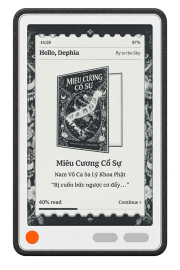</a> | <a href="web/assets/home-new.webp">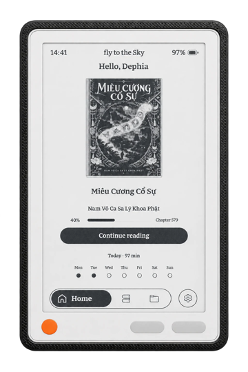</a> | <a href="docs/screenshots/interface/library.png">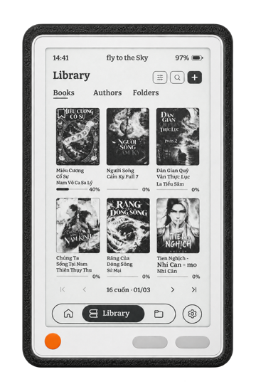</a> |
| :---: | :---: | :---: | :---: |
| Đầy đủ | I Love Book | New Home | Tủ sách |

## dpReader 1.7.3

Firmware đọc EPUB và TXT dành cho **Metalio E-Ink 4 Plus 4,7 inch** (`metalio4.7`, ESP32-S31, flash 16 MB).

  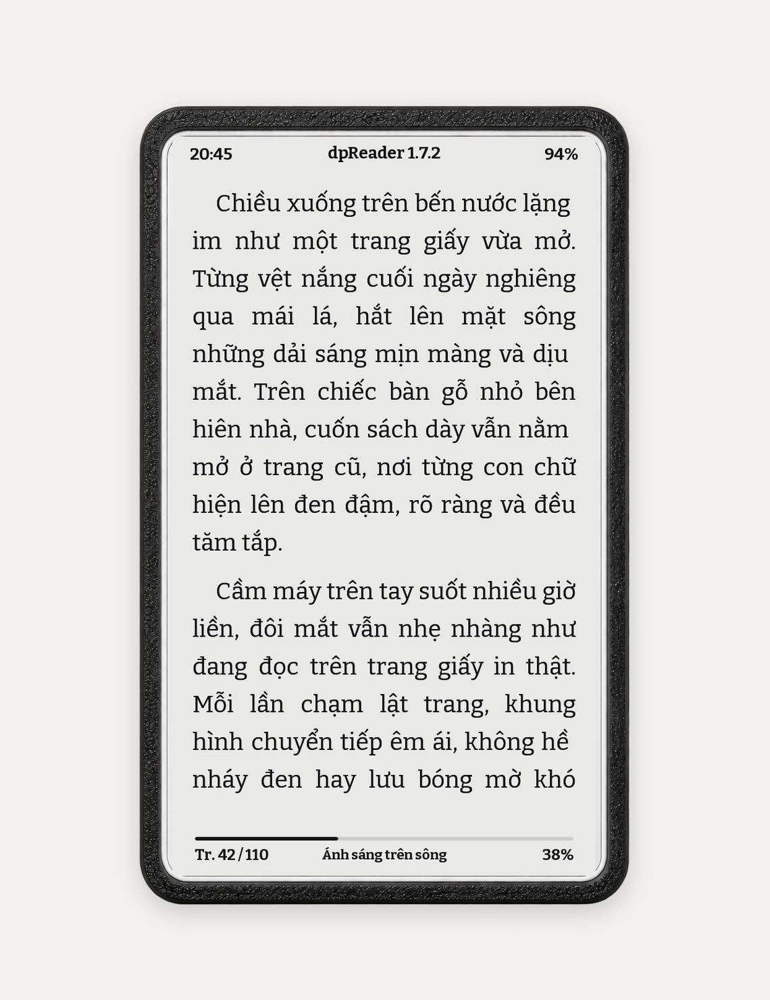

[Web Flash](https://dephia31.github.io/dpReader31/) · [Tải firmware 1.7.3](https://github.com/dephia31/dpReader31/releases/tag/v1.7.3-vn)

### 1. Màn hình khóa mới: Ghép bìa Tủ sách (C1/C3/C4) & Bìa sách đang đọc (B1/B3)

  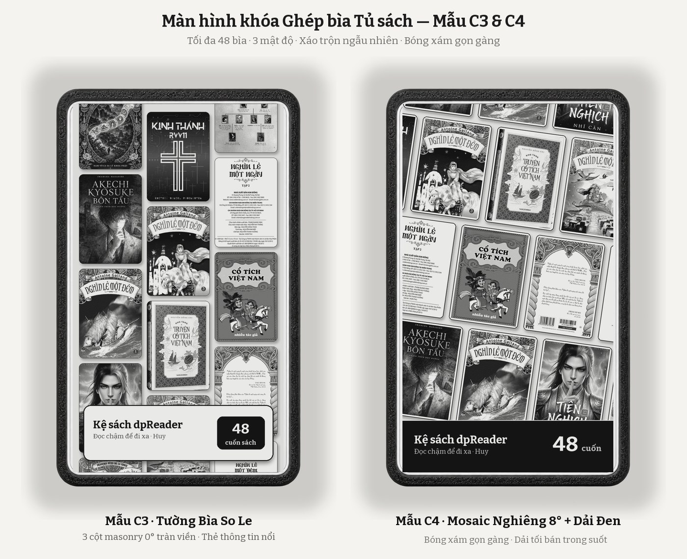

- **Ghép bìa Tủ sách (bản Full)**: Nâng cấp tốc độ dựng nhanh hơn hẳn, hỗ trợ 3 phong cách **C1** (nghiêng cổ điển), **C3** (tường bìa 3 cột so le 0° + thẻ nổi) và **C4** (nghiêng nhẹ 8°, bóng xám gọn gàng, dải tối bán trong suốt). Chọn tới **48 cuốn sách**, 3 mật độ bìa, sắp xếp theo **Gần đây / Xáo mỗi lần khóa / Ngẫu nhiên cố định**, kèm nút **Xáo lại** chớp phản hồi và đếm `#N`.

  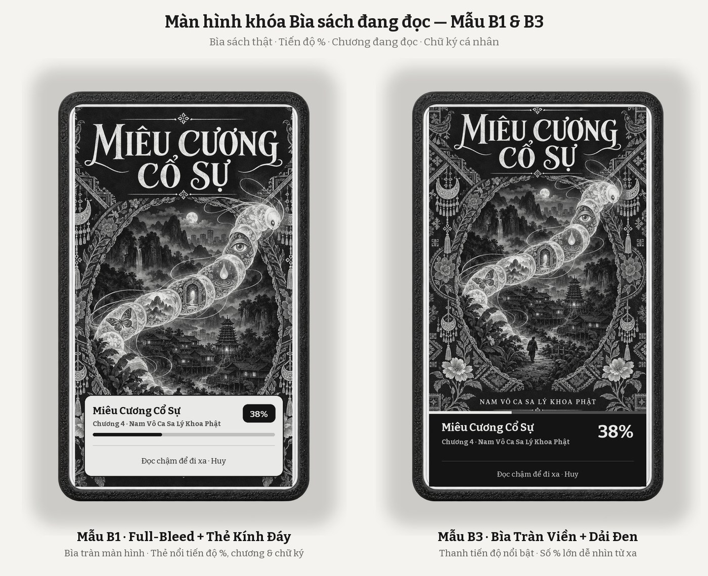

- **Bìa sách đang đọc (Full & Love Book)**: Hiển thị bìa cuốn sách đang đọc, tên chương, thanh tiến độ `%` và chữ ký cá nhân theo 2 kiểu: **B1** (thẻ nổi bo góc) và **B3** (dải thông tin tối bán trong suốt + dải chữ ký đen đặc sát đáy).

### 2. Chữ siêu nét như in giấy: `dpMetal Core`, `dpMetal Bold` & `dpMetal Dark`

  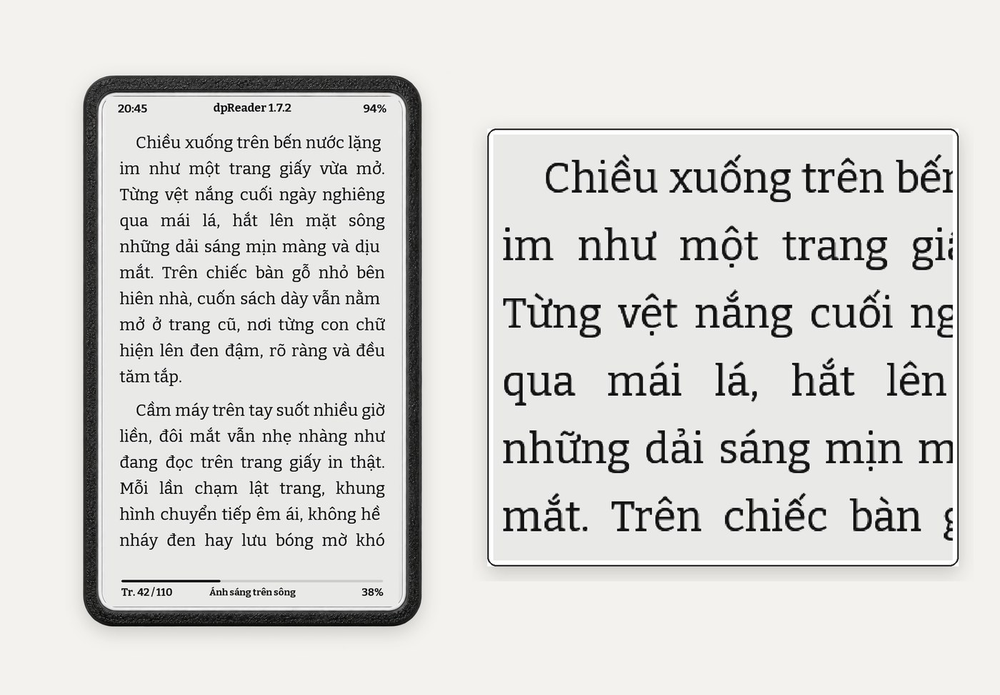

- **Chữ đen sâu, hết bạc màu cuối lượt quét**: Tinh chỉnh các dạng sóng `GC48`, `GC36`, `GL37` và `22 pha` kết hợp tăng tốc **Core 1 RISC-V PIE SIMD**, giữ lực kéo đen sâu ngay cả với nét chữ mảnh.
- **Chế độ mới `dpMetal Dark` (trong `dpMetal Core`)**: Giữ nguyên nét thanh thoát của `dpMetal Core`, lật trang nhanh 22 pha và làm mới định kỳ bằng `GC48` cho độ tương phản đen đậm hơn rõ rệt.
- **`dpMetal Bold` & chữ nhãn giao diện sắc mịn**: Nét chữ đen đậm đồng đều ở mọi cỡ chữ, không nháy đen cuối lượt lật trang; toàn bộ menu đọc sách, Mục lục, popup chọn và Quick Setting dùng raster `dpMetal Bold`.
- **Mặc định tối ưu**: Giữ **`dpMetal Core`** làm mặc định, tự động bật **Chữ cái đầu đoạn lớn (`Lớn · Nhô lên`)** và tắt mặc định **Phông chữ nhúng trong sách**.

### 3. Sóng nước 2 lựa chọn (22 pha & 37 pha), tối ưu SRAM & vuốt mép trái quay lại

  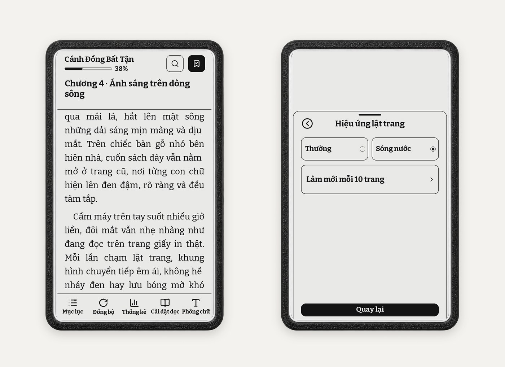

- **2 lựa chọn hiệu ứng Sóng nước**: Chọn **Sóng nước nhanh (22 pha)** để ưu tiên tốc độ, hoặc **Sóng nước mượt (37 pha)** để chuyển trang êm dịu mà chữ vẫn đen sâu.
- **Tối ưu SRAM nội bộ & an toàn nguồn**: Đặt dữ liệu ngắt I2C, cảm ứng, bộ mở rộng I/O và gia tốc kế vào SRAM nội bộ (`CONFIG_I2C_ISR_IRAM_SAFE=y`); tự động lưu tiến độ, đồng bộ thẻ SD và tắt nguồn an toàn khi pin cạn; tắt sạch I/O, rung và xung màn hình khi ngủ sâu.
- **Menu đọc sách tải nhanh & vuốt mép trái quay lại**: Đóng/mở đồng thời thanh công cụ trên & dưới trong một lượt quét duy nhất; **vuốt phải từ mép trái** để quay lại trong toàn bộ menu đọc sách (dọc & ngang) và Mục lục.

### 4. Quick Setting & Đèn nền sáng dần êm mắt

  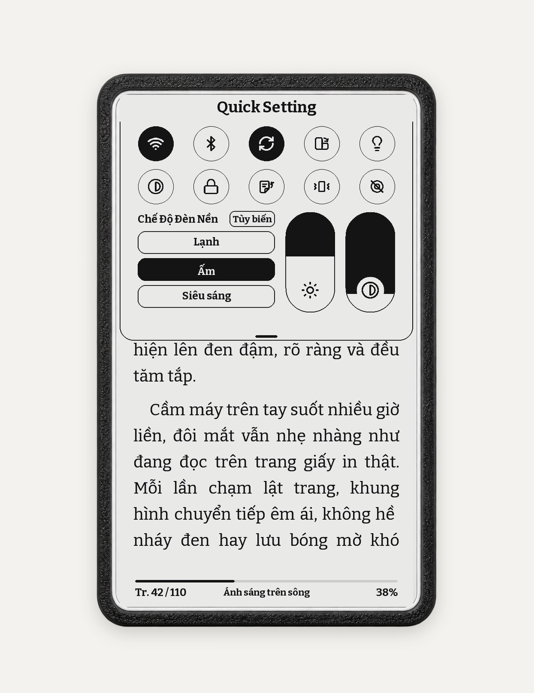

- Kéo từ cạnh trên để mở **Quick Setting** với **10 nút bật/tắt nhanh**, **3 cấu hình đèn nền** (đổi tên được bằng tiếng Việt UTF-8) và **2 thanh trượt độ sáng / nhiệt màu**.
- Đèn nền **sáng dần mềm mại (soft-start)** đồng nhất khi thức từ cả **Light Sleep** và **Deep Sleep**.

### 5. Tìm kiếm tiếng Việt trong sách, Mục lục thông minh & Kết nối

  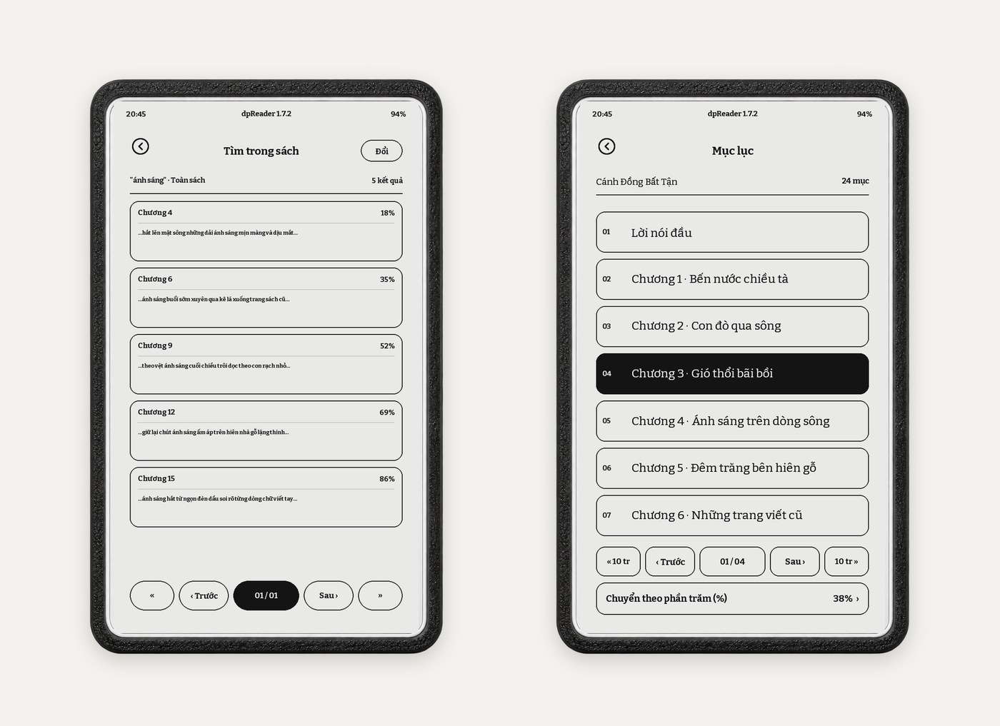

- **Tìm kiếm nội dung trong sách (TXT & EPUB)**: Hỗ trợ tiếng Việt có dấu và không dấu, lưu từ khóa gần đây, nút **Dừng & xem kết quả** tức thì, tìm nhanh từ menu chọn chữ.
- **Mục lục cha–con & nhảy theo phần trăm (%)**: Hỗ trợ đầy đủ cả hướng dọc và xoay ngang.
- **Kết nối đa dạng**: **KOSync**, duyệt kho sách **OPDS**, truyền sách qua **Wi-Fi / Hotspot / USB**, và điều khiển **nút lật trang Bluetooth**.

## Chọn phiên bản và giao diện

  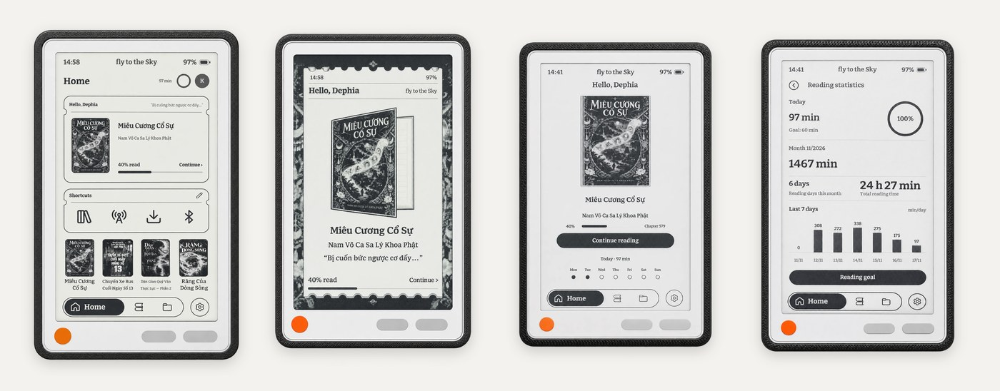

- **Full** có Tủ sách dạng bìa, tìm kiếm, sách yêu thích, lịch sử, công cụ quản lý và màn hình khóa **Ghép bìa Tủ sách**. Home Đầy đủ hiển thị sách đang đọc, tiện ích và sách gần đây.
- **Love Book** dùng trình chọn tệp để mở sách. I Love Book tập trung vào cuốn đang đọc với bìa hé mở, tiến độ và màn hình khóa **Bìa sách đang đọc**.
- **New Home** có trên cả hai phiên bản. Chạm **Đọc tiếp** để mở sách hoặc chạm vùng **Hôm nay** để xem thống kê. Chọn tại **Cài đặt → Cá nhân hóa → Giao diện**.

## Đọc sách và theo dõi tiến độ

Tùy chỉnh phông chữ, cỡ chữ, lề, giãn dòng và phím lật trang. Màn **Thống kê đọc sách** hiển thị số phút hôm nay, thời gian và số ngày đọc trong tháng, tổng thời gian và biểu đồ bảy ngày. Đặt số phút muốn đọc mỗi ngày trong **Mục tiêu đọc**.

  
  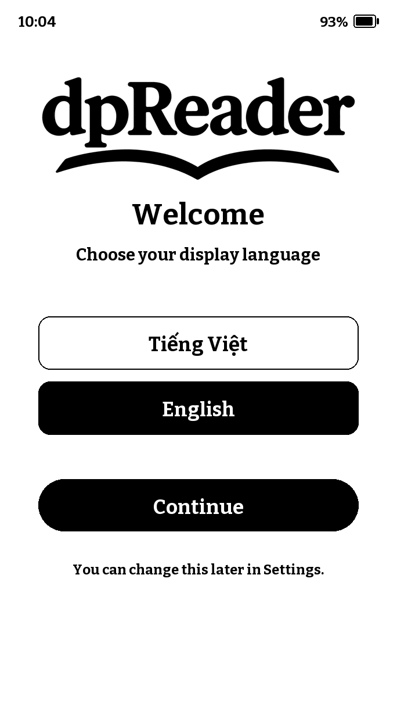

## Cài đặt và cập nhật

1. Sao lưu cấu hình ra microSD. Nếu có thể cần quay về 1.5.1, giữ riêng bản sao lưu trước khi nâng cấp. Bản sao lưu có lựa chọn ngôn ngữ của 1.5.2 dùng định dạng V33.
2. Mở **Web Flash** bằng trình duyệt hỗ trợ Web Serial, kết nối máy bằng cáp USB-C có truyền dữ liệu và chọn Full hoặc Love Book. Nếu máy không hiện trong danh sách cổng, làm theo hướng dẫn vào BOOT trên trang.
3. Chọn **Cập nhật ứng dụng** nếu máy đang chạy dpReader 1.4.2 trở lên với bố cục NVS 256 KiB. Chọn **Nạp toàn phần** khi chuyển từ firmware khác, từ 1.4.1 trở xuống hoặc khi cần cứu máy. Nạp toàn phần xóa bộ nhớ trong và giữ nguyên thẻ microSD.
4. Kiểm tra phiên bản sau khi máy khởi động lại. Với máy đã dùng bố cục tương thích, có thể cập nhật qua Wi-Fi từ 1.4.3 hoặc dùng gói cập nhật microSD.

[Bộ USB Full](releases/dpReader-metalio47-1.7.3-vn-USB.zip) · [Bộ USB Love Book](releases/love-book/dpReader-metalio47-1.7.3-love-vn-USB.zip) · [Hướng dẫn sao lưu](docs/BACKUP_AND_RESTORE.md)

## Chép sách và đổi ngôn ngữ

Chép EPUB hoặc TXT vào thư mục sách trên microSD hoặc mở **Tệp** để truyền qua Wi-Fi, hotspot hay USB. Có thể duyệt kho OPDS và cài đặt KOSync trong phần kết nối.

Màn Welcome cho chọn **Tiếng Việt** hoặc **English** khi cài mới. Đổi ngôn ngữ bất cứ lúc nào tại **Cài đặt → Cá nhân hóa → Ngôn ngữ**. Tên sách, tác giả và nội dung sách hiển thị theo dữ liệu gốc.

[Hướng dẫn cài đặt và sử dụng](docs/CAI_DAT.md) · [Giấy phép](LICENSE) · [Thông báo bên thứ ba](THIRD_PARTY_NOTICES.md)

## English overview

dpReader is EPUB and TXT reading firmware for the **Metalio E-Ink 4 Plus (4.7-inch, ESP32-S31)**. Version **1.7.3** adds upgraded Cover-collage (C1/C3/C4, 48-book pool, shuffle feedback) and Current-book cover (B1/B3) lock screens, dual water-ripple page turns (22-phase fast & 37-phase smooth), **`dpMetal Dark`** mode with deeper black text contrast, internal SRAM I2C/touch safety, critical-battery safe shutdown, and unified soft-start frontlight wake. Choose **Full** for the cover library or **Love Book** for a simpler file-based reading experience.

[Read the full English guide](README.en.md) · [Open Web Flash in English](https://dephia31.github.io/dpReader31/?lang=en)
